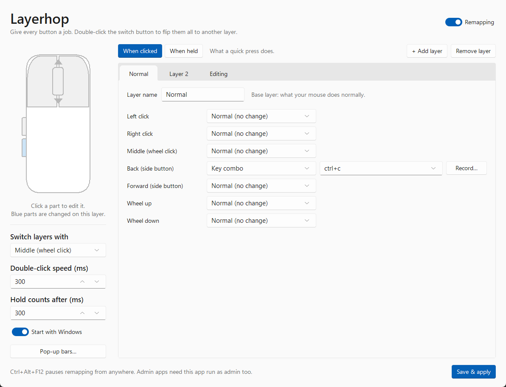
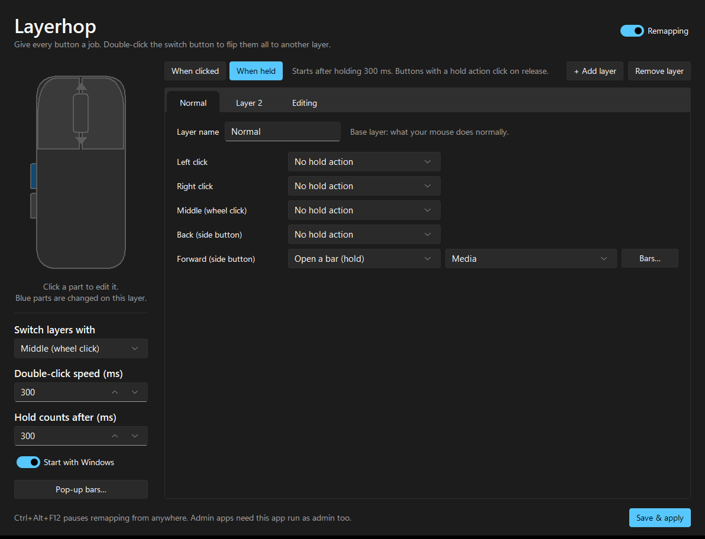

# Layerhop

Give every mouse button more than one job. Double-click one button to flip all the others to a different layer, or hold a button to open a pop-up bar of shortcuts under your cursor.



## What it does

- **Layers.** Each layer has its own action for every button. Layer 1 is how your mouse normally behaves; double-click the switch button (middle click by default) to jump to the next layer. An on-screen label shows which layer is active.
- **Click and hold actions.** Every button can do one thing when clicked and another when held.
- **Pop-up bars.** Hold a button, slide to a bar button, let go to run it. Let go off the bar to cancel. Bars can hold programs, media keys, key combos, typed text, or mouse buttons.
- **Actions.** Mouse button, key combo, media key, type text, open a program, file or website, or do nothing.
- **Tray app.** Closing the window keeps it running in the system tray. It can start with Windows.



## Using it

1. Click a part of the mouse picture, or pick a row, to choose what that button does.
2. Switch between **When clicked** and **When held** to set both actions.
3. Use **+ Add layer** for more layers.
4. Press **Save & apply**. An "Unsaved changes" marker shows until you do.

Blue parts of the mouse are buttons that are changed on the current layer.

Press **Ctrl+Alt+F12** at any time to pause or resume remapping. If you change Left click, this is your way out if something goes wrong.

## Run it

Windows only. Needs Python 3.10+.

```bash
pip install pillow sv-ttk pystray
python main.py          # add --tray to start hidden in the tray
```

`sv-ttk` (the Windows 11 look) and `pystray` (the tray icon) are optional. Without the tray icon, closing the window quits the app.

Settings are saved to `%APPDATA%\Layerhop\config.json`. Settings from the earlier "Mouse Layers" name are copied over on first run.

## Supported mice

Layerhop listens to the standard Windows mouse events, so it works with any wired, 2.4 GHz or Bluetooth mouse that shows up as a normal Windows mouse. It can remap these seven inputs:

| Input | Remappable |
| --- | --- |
| Left click | Yes (not as the layer switch) |
| Right click | Yes |
| Middle (wheel click) | Yes |
| Back and Forward side buttons | Yes |
| Wheel up and down | Yes (click actions only) |

Not supported: buttons that the mouse handles itself and never sends to Windows, such as DPI switches, profile buttons and tilt wheels. A mouse with only left, right and middle buttons works, but has fewer buttons to remap.

### Portronics Vader

The Portronics Vader family (Vader wired, Vader Pro, Vader Max) is a 6-button design: left, right, wheel click, two thumb buttons and a DPI button. The thumb buttons are the Back and Forward buttons in Layerhop, so they are the natural switch and pop-up bar buttons. The DPI button changes the sensor in the mouse and isn't visible to Windows, so it can't be remapped.

This is based on the published specs and hasn't been tested on a real Vader. To check a button, press it with the Layerhop window open: the matching part of the mouse picture lights up when Layerhop sees it.

## Notes

- Apps running as administrator only see remapped buttons if Layerhop is also run as administrator.
- Left click can't be used as the switch button, because it would delay every left click while waiting for a possible double-click.

## Tests

```bash
python -m pytest test_remap.py
```
